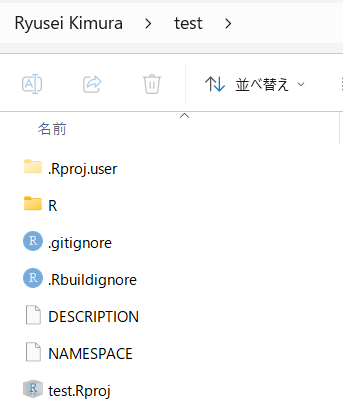
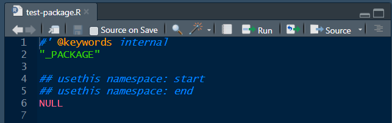
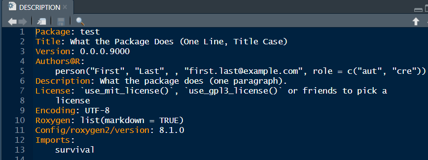
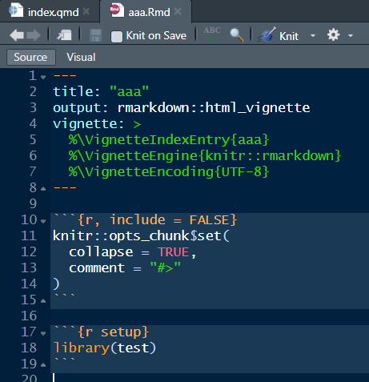
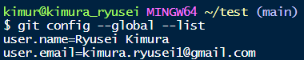

# 準備

- **R・RStudio**：実行環境と開発環境．
- **Git・GitHubアカウント**：変更履歴の管理と共有．CRAN提出自体には必須でない．
- **GitHub CLI**（`gh`）：GitHubを使うなら，あると結構便利．
- **Rtools（Windows）**：C/C++/Fortranを含むソースのビルドに必要．

| Rパッケージ          | 用途                                               |
|:---------------------|:---------------------------------------------------|
| `devtools`           | 読み込み・ヘルプ生成・テスト・check・build，必須   |
| `usethis`            | パッケージや開発用ファイルの初期設定，必須         |
| `roxygen2`           | コメントからヘルプと `NAMESPACE` を生成，必須      |
| `testthat`           | 自動テスト，あると便利                             |
| `knitr`・`rmarkdown` | vignette（使い方の文書），vignette作るなら必須     |
| `pkgdown`            | パッケージを紹介するWebサイトを作成， 必須ではないが最近の流行り |
| `remotes`            | GitHubなどからのインストール，あると便利           |
| `rhub`               | CRAN提出前に別環境でのチェック， あると便利                    |

```{r}
install.packages(c(
  "devtools", "usethis", "roxygen2",
  "testthat", "knitr", "rmarkdown",
  "pkgdown", "remotes", "rhub"
))
```

# CRAN提出までの手順

1.  **パッケージを作成する**
    - 新規パッケージプロジェクトの作成
    - R関数の実装
    - roxygen2によるヘルプページの作成
    - `DESCRIPTION` と `NAMESPACE` の設定
    - README.md，NEWS.mdの作成
    - 不要ファイルの除外設定（`.gitignore`，`.Rbuildignore`）
    - データセットの作成（任意）
    - testthatによるテストコードの作成（任意）
    - vignetteの作成（任意）
    - pkgdownによるwebページの作成（任意）
2.  **パッケージのテストを実施する**
    - ローカル環境での `R CMD check`
    - Win-builderによるチェック（30分程度？らしい）
    - R-hubによるチェック（必要に応じて）
3.  **CRANにパッケージを提出する**
    - ソースパッケージ（`.tar.gz`）の作成
    - CRAN提出フォームからのアップロード
    - 確認メール，指摘事項への対応

# Rパッケージの開発

## RStudioのセットアップ

1.  R Studioの`File`タブから`New Project`→`New Directory`→`Package using devtools` を選択する．

2.  初期ファイルが生成される．

    

3.  `Tools` → `Project Options` → `Build Tools` → `Check package -- R CMD check additional options:`の空欄に`--as-cran` と追記する．

    - `R CMD check` 実施時に そのオプションが自動で適用される．

4.  `Tools` → `Project Options` → `Git/SVN` → `Version control system:`で`Git`を選択する．

- 既存のR Projectをパッケージに変換する場合：

```{r}
usethis::create_package(".")
```

## Rスクリプト

- `R/` ディレクトリ内にRスクリプトを格納する．
- 以下を実行し，`<pkgname>-package.R`を生成しておく．
  - パッケージのトップレベルヘルプを作成できる．

```{r}
usethis::use_package_doc()
```



## DESCRIPTION

- 著者情報やライセンスを記載する
- パッケージのバージョンを記載する

| 変更例 | 位置づけ |
|:-----------------------------------|:-----------------------------------|
| `0.0.0.9000` → `0.1.0` | 開発版からの初期バージョンへの更新 |
| `0.1.0` → `0.1.1` | patch：バグ修正などの小変更 |
| `0.1.0` → `0.2.0` | minor：機能追加 |
| `0.1.0` → `1.0.0` | major：大きな変更，後方互換性を壊す可能性がある変更 |

- 以下を実行し，依存パッケージ（Imports）を記載する．
  - 手書きでもOK

```{r}
usethis::use_package("rpackage名")
```



## NAMESPACE

- `NAMESPACE`は後述のroxygen2によって自動で追記修正される．手作業では変更しない．
- roxygen2コメント記載後，`Ctrl + Shift + D` でドキュメントを更新すると，`NAMESPACE` に反映される．

## roxygen2

- 各Rスクリプトの冒頭に記載したコメントに基づき，ヘルプやexampleなどのdocumentationを生成・管理する機能のこと
- 関数の冒頭に，使用する外部パッケージの指定，自作関数の公開または内部利用のみなどの指定なども行う
- スクリプト上で`package::function()`形式でパッケージ名を明示すれば下記は省略可

```{r}
#' @importFrom aaa
```

## .gitignore

- Git管理対象から除外するファイルやディレクトリを記載する
  - `.Rproj.user`は最初から記載されている．

```{r}
usethis::use_git_ignore(c(".Rhistory", ".Rproj.user"))
```

## .Rbuildignore

- ソースパッケージ（`.tar.gz`）に含めないファイルやディレクトリを記載する．
  - `usethis` や `devtools` の一部の関数では、必要な除外設定が自動的に追加される．
  - それ以外のファイルまたはディレクトリを除外したい場合は，以下の関数で追加する．

```{r}
usethis::use_build_ignore("aaa")
```

## データセットの作成

- exampleで使用するデータセットをパッケージに含めることができる
- データセットを乱数生成する場合は生成用のスクリプトを用意する

```{r}
usethis::use_data_raw("example_data") # data-raw/example_data.Rが生成される
```

- `example_data.R`には，データ生成コードと`usethis::use_data()`を記載し，一度ファイルを実行しておく．

```{r}
example_data <- data.frame(
  trt = c(0, 1, 0, 1, 0),
  time = c(10, 15, 8, 20, 12),
  event = c(1, 0, 1, 1, 0)
)

usethis::use_data(example_data, overwrite = TRUE) # data/example_data.rdaが生成される
```

## Vignette

- パッケージの使用例を説明する文書のこと，必須ではない

```{r}
usethis::use_vignette("aaa") # vignettes/introduction.Rmd が生成される
```



## README.mdとNEWS.md

```{r}
usethis::use_readme_md()
usethis::use_news_md()
```

## pkgdown

- パッケージを紹介するWebサイトが簡単に作成できる
- プライベートリポジトリ上ではwebページを公開できない（無料版の場合）

1. 以下を実行し，pkgdownの設定ファイルを作成する

```{r}
usethis::use_pkgdown()
```

- `_pkgdown.yml` が生成され，サイトの構成・フォントなどが設定できる
- `.Rbuildignore` などにも必要な除外設定が追加される

2. 以下を実行し，Webサイトをローカルで生成・確認する

```{r}
pkgdown::build_site()
```

## testthat

- テストコードを管理するディレクトリのこと，必須ではない．
- 大規模なパッケージだとGitHubで公開されていることが多い．

```{r}
usethis::use_testthat()
usethis::use_test("aaa") # tests/testthat/test-aaa.Rを作成
```

## パッケージファイルのテスト

- CRAN登録前に，CRAN公式のパッケージファイルのテストを行う必要がある．
  - [Win-builder](https://win-builder.r-project.org/)

## Rstudioで使う主なコマンド

| 操作 | コマンド | RStudioでのGUI操作 | ショートカットキー |
|:-----------------|:-----------------|:-----------------|:-----------------|
| 開発中の関数を読み込む | `devtools::load_all()` | Build → Load All | `Ctrl + Shift + L` |
| パッケージをインストール | `devtools::install()` | Build → Install and Restart | `Ctrl + Shift + B` |
| ヘルプ・NAMESPACEを更新 | `devtools::document()` | Build → Document | `Ctrl + Shift + D` |
| テストコードを実行 | `devtools::test()` | Build → Test Package | `Ctrl + Shift + T` |
| パッケージをチェック | `devtools::check()` | Build → Check Package | `Ctrl + Shift + E` |
| ソースパッケージを作成 | `devtools::build()` | Build → More → Build Source Package | — |

ソースパッケージの形式は `.tar.gz`，Windows向けのバイナリパッケージの形式は通常 `.zip` である．

# Git/Githubで管理する

## ローカルの初期設定

- Rstudioのターミナルなどで以下を実行し，ユーザー名とアドレスをgitに一度登録する
  - ユーザー名はGitHubのユーザー名と同じでなくてよいが，アドレスは同じものを使ったほうが無難

``` {bash}
git config --global user.name "Your Name"
git config --global user.email "your-email@example.com"
```

- 以下のコードで登録できたか確認できる

``` {bash}
git config --global --list
```



## GitHubの認証
- SSH方式とHTTPS方式があり，PCごとに行う
- GitHub CLIを利用すると、以下のコマンドで認証設定を進められる．

``` {bash}
gh auth login
```

- SSH方式の設定方法（必須ではない）
  1.  `Tools` → `Global Options` → `Git/SVN` → `SSH key:`の下の`Create SSH key..`をクリックし，SSHキーを作成する．
  2.  SSHキー（公開鍵）をコピーする
  3.  GitHubにログインし，ユーザーページの`Settings` → `SSH and GPG keys` → `New SSH key`をクリックし，公開鍵を貼り付けて登録する

## GitHubリポジトリとの連携

### 方法1：Gitコマンドで設定する

- SSH方式とHTTPS方式があり，リポジトリごとに行う

1.  GitHub上にリモートリポジトリを作成する
2.  ローカルリポジトリにリモートURLを登録する

- SSH方式

```{bash}
git remote add origin git@github.com:rkimura1/sim-rbci.git
```

- HTTPS方式

```{bash}
git remote add origin https://github.com/rkimura1/sim-rbci.git
```

3.  初回のステージング，commit，push

```{bash}
git add .
git commit -m "initial commit"
git push -u origin main
```

### 方法2：

1.  ローカルで初回commitを完了する．GitHubの認証設定（PATなど）も必要になる．
2.  Rstudioで以下を実行すると，プライベートリポジトリがGitHub上で作成され，pushまで行われる．

```{r}
usethis::use_github(private = TRUE)
```

## Bash・Gitの基本操作

### よく使うBashコマンド一覧

| コマンド                    | メモ                                 |
|:----------------------------|:-------------------------------------|
| `pwd`                       | 現在のディレクトリ                   |
| `cd dir` / `cd ..` / `cd -` | 指定先／親／直前のディレクトリへ移動 |
| `ls` / `ls -l`              | ファイル一覧／詳細一覧               |
| `cat file` / `head file`    | 全文／先頭を表示                     |
| `mkdir dir`                 | ディレクトリを作成                   |
| `rm file` / `rm -r dir`     | ファイル／ディレクトリを削除         |

- `~` はホームディレクトリ

### よく使うGitコマンド一覧

| コマンド                | メモ                                           |
|:------------------------|:-----------------------------------------------|
| `git fetch`             | リモートの更新を取得．作業ファイルは変更しない |
| `git pull --ff-only`    | 分岐していない場合に，リモートの変更を取り込む |
| `git log --oneline`     | コミット履歴                                   |
| `git switch -c aaa`     | 作業ブランチを作って移動                       |
| `git switch main`       | mainへ移動                                     |
| `git branch -a`         | ローカル・リモート追跡ブランチの一覧           |
| `git branch -d aaa`     | マージ済みの作業ブランチを削除                 |
| `git branch -m old new` | ブランチ名を変更                               |

# リンク集

- [R Packages (2nd edition)](https://r-pkgs.org/)\
- [CRAN Repository Policy](https://cran.r-project.org/web/packages/policies.html)
- [Checklist for CRAN Submissions](https://cran.r-project.org/web/packages/submission_checklist.html)
- [CRAN Submission](https://cran.r-project.org/submit.html)
- [Win-builder](https://win-builder.r-project.org/)
